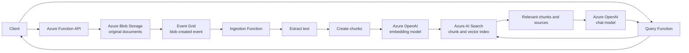

# Azure Architecture

This document describes the Azure architecture for the AI Support Assistant.
The application answers questions about a small collection of Azure and Python
troubleshooting documents. It must answer from retrieved evidence and must say
when the available documents do not contain enough evidence.

## Services

| Service | Resource name | Responsibility |
| --- | --- | --- |
| Resource group | `rg-ai-support-dev` | Holds the resources for one environment. |
| Storage account | `staisupportdev<unique>` | Stores original uploaded documents and optional processed chunk files. Storage account names must be globally unique and use lowercase letters and numbers. |
| Blob container | `documents` | Stores the original files. The application does not modify these files. |
| Blob container | `processed` | Optionally stores extracted text and chunk JSON for auditing and reprocessing. |
| Azure Function App | `func-ai-support-dev-<unique>` | Hosts the upload, ingestion, and question-answering API functions. |
| Event Grid | `evg-ai-support-dev` | Starts document ingestion after a blob is created. |
| Azure AI Search | `srch-ai-support-dev-<unique>` | Stores document chunks, metadata, and vectors for hybrid retrieval. |
| Azure OpenAI | `aoai-ai-support-dev` | Creates embeddings and generates grounded answers. |
| Application Insights | `appi-ai-support-dev` | Collects logs, failures, and performance telemetry. |
| Log Analytics workspace | `law-ai-support-dev` | Stores and queries application logs. |
| Key Vault | `kv-ai-support-dev-<unique>` | Stores secrets and service credentials. Key Vault names must be globally unique. |

Use a suffix such as `a1b2c3` for resources that require globally unique
names. Use separate resource groups and resource names for development,
staging, and production.

## Request and Ingestion Flow



## Where Documents Are Stored

The original upload is stored in the `documents` Blob container. Use a stable
path that includes the document ID:

```text
documents/{document_id}/{file_name}
```

The original file should be retained so it can be downloaded, reprocessed, or
audited later. Do not use the search index as the source of truth for the
original file.

Store document metadata separately from the file contents. At minimum, track:

```text
document_id
file_name
blob_path
content_type
version
status
uploaded_at
processed_at
error_message
```

For the first version, this metadata can be stored in a JSON sidecar in Blob
Storage. A database such as Azure Cosmos DB can be added later if the project
needs richer status queries, ownership, or document history.

## Where Chunking Happens

Chunking happens in the ingestion Function after Event Grid reports a new blob.
The Function should:

1. Read the original file from Blob Storage.
2. Extract text from the file.
3. Split text into overlapping chunks.
4. Create an embedding for each chunk with Azure OpenAI.
5. Upload the chunks and embeddings to Azure AI Search.

For PDF files that contain scans or complex layouts, add Azure AI Document
Intelligence before chunking. For the initial text and simple PDF collection,
the Function can use a lightweight text/PDF loader.

Azure Functions is appropriate for the initial project. Use Durable Functions
or Azure Container Apps Jobs if processing becomes long-running or requires
large amounts of memory.

## Where Chunks Are Stored

Azure AI Search is the runtime store for chunks. Each search document should
contain fields similar to these:

```text
chunk_id       unique ID for the chunk
document_id    ID of the source document
content        chunk text
contentVector  embedding vector
file_name      original file name
blob_path      source Blob Storage path
page_number    source page when available
version        document version
```

The `content` field is used for keyword search. The `contentVector` field is
used for vector search. Hybrid search combines both and is the recommended
retrieval mode for this project.

Optionally write the extracted text and chunks to:

```text
processed/{document_id}/{version}/chunks.json
```

This is useful for audit and re-indexing. The query API should retrieve chunks
from Azure AI Search, not from the processed JSON files.

## New Document Lifecycle

When a user uploads a new document:

1. The upload API validates the file name, content type, size, and metadata.
2. The original file is written to the `documents` container.
3. Metadata is set to `uploaded`.
4. Blob creation triggers Event Grid.
5. The ingestion Function sets the status to `processing`.
6. Text is extracted and split into chunks.
7. Embeddings are created and indexed in Azure AI Search.
8. The document status becomes `ready`.
9. The document can now be used by the query endpoint.

If processing fails, set the status to `failed`, save the error message, and do
not publish partial chunks as ready content.

If the same document is uploaded again, create a new version. Index the new
version only after all chunks have been processed successfully. Then remove or
mark the old version inactive so search does not return stale content.

## Query Flow

1. The client sends a question to the query Function.
2. The Function validates the request with a Pydantic `BaseModel`.
3. Azure OpenAI creates a query embedding.
4. Azure AI Search performs hybrid search and returns the best chunks.
5. A relevance threshold decides whether there is enough evidence.
6. If evidence is insufficient, the API returns a refusal instead of guessing.
7. Otherwise, the Function sends the question and retrieved chunks to the chat
   model.
8. The response includes the answer and source document references.

Use Pydantic models for API requests, API responses, configuration, and data
loaded from Azure services. Use Python `@dataclass` only for trusted internal
objects such as an already-validated chunk passed between application
functions.

## Security and Operations

- Enable managed identity for the Function App where supported.
- Give the Function identity only the required Blob, Search, OpenAI, and Key
  Vault permissions.
- Store secrets in Key Vault and reference them from Function App settings.
- Keep storage private and use HTTPS-only access.
- Enable logging with Application Insights.
- Never log document contents, access tokens, or API keys.
- Configure Blob Storage soft delete and lifecycle rules.
- Use separate Azure resources for each environment.

## Initial Scope

The first milestone uses one resource group, one storage account, one Function
App, one Azure AI Search service, and one Azure OpenAI resource. Evaluation
with DeepEval is intentionally outside this document and will be added later.