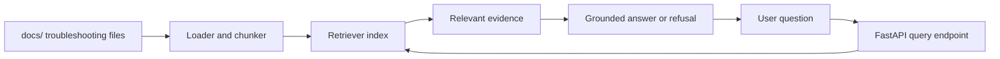

# AI Support Assistant

An evidence-grounded assistant for questions about a small collection of Azure
and Python troubleshooting documents. The assistant retrieves relevant document
content before answering and refuses questions when the collection does not
provide enough evidence.

## Milestone 1

The first working slice will:

1. Load trusted troubleshooting documents from `docs/`.
2. Split and index their content for retrieval.
3. Accept a user question through the FastAPI endpoint.
4. Return an answer supported by retrieved context and its source documents.
5. Return an explicit insufficient-evidence response when no relevant context
   is found.

The implementation will follow the standard RAG flow: document loading,
chunking, embedding or indexing, retrieval, and grounded answer generation.

## Repository Layout

```text
README.md       Project scope, setup, and behavior
prompts/        Assistant instructions and intent definitions
evals/          Evaluation questions and expected outcomes
src/            FastAPI application and retrieval code
docs/           Source troubleshooting documents
```

## Setup

From this directory:

```bash
python3 -m venv .venv
source .venv/bin/activate
pip install -r requirements.txt
```

Set the required configuration before starting the application:

```bash
export ADMIN_EMAIL=admin@example.com
```

## Run

```bash
uvicorn src.main:app --reload
```

## API

- Ask a question: `POST /assistant/v1/query`
- List documents: `GET /assistant/v1/docs`
- View one document: `GET /assistant/v1/doc/<doc_id>`

## Assistant Behavior

- Answer only from the troubleshooting documents in `docs/`.
- Cite or identify the source document used for an answer.
- State when the evidence is insufficient instead of guessing.
- Do not provide unrelated general knowledge, secrets, or unsupported
  production changes.
- Treat uploaded or external content as untrusted input and validate it at the
  application boundary.

## Evaluation

The evaluation set will contain 10 questions covering supported Azure and
Python troubleshooting topics, paraphrased questions, and questions that must
be refused because the documents do not contain the answer. Expected answers
and refusal outcomes will live in `evals/`.

## Architecture

